# Rewind Studio

**A Plex year in review for any server.** Turn your server's playback stats into an Instagram-ready recap: five slides, a single-page infographic, or a 30-second animated video with sound, in seven designed styles. It all runs on your own machine from a backup of your Plex database. There's no hosted service, Plex token or account involved.

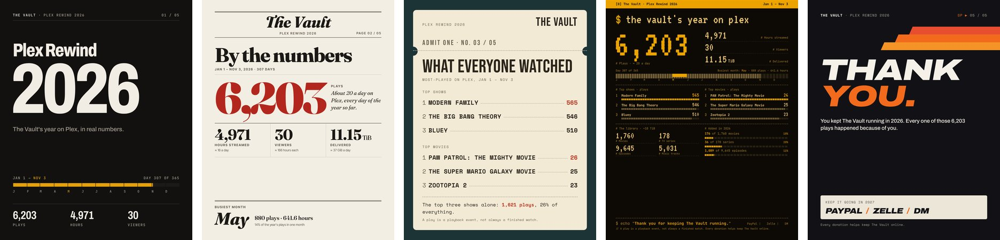

## What you get

| Output | Files | Best for |
|---|---|---|
| Five slides | `slide-1.png` … `slide-5.png` | An Instagram carousel |
| Infographic | `infographic.png` | One feed post with everything on it |
| Video | `rewind.mp4` (about 30 s, with sound) | A video post |

Everything is 1080 × 1350 (4:5), Instagram's portrait feed size.

The slides cover the year in order: **the cover** with how far into the year the stats run, **the numbers** (plays, hours, viewers, data delivered, the busiest month), **what everyone watched** (top shows and movies), **the library** (what's on the server and how much of it is new this year), and **a closing slide** that can thank people or ask for donations.

| The video | The infographic |
|:---:|:---:|
|  | 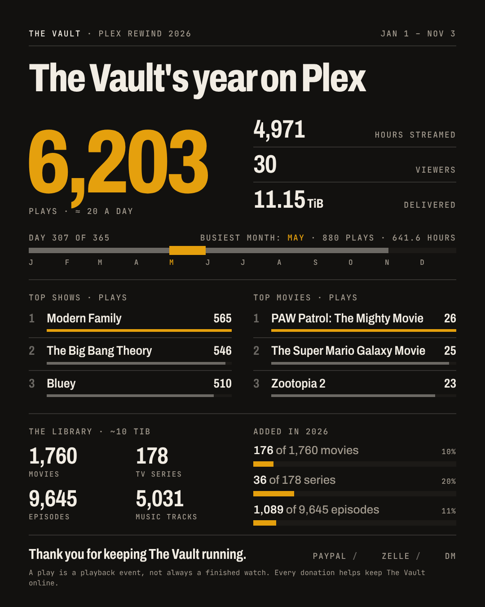 |

## Quick start

You need [Python 3.10+](https://www.python.org/downloads/). For video, also install [ffmpeg](https://ffmpeg.org/download.html).

```bash
git clone https://github.com/antonflor/rewind-studio.git
cd rewind-studio
python -m pip install -r requirements.txt
python -m playwright install chromium

python rewind.py render --data examples/odyssey-2026.json --name "The Vault" --format all --out output
```

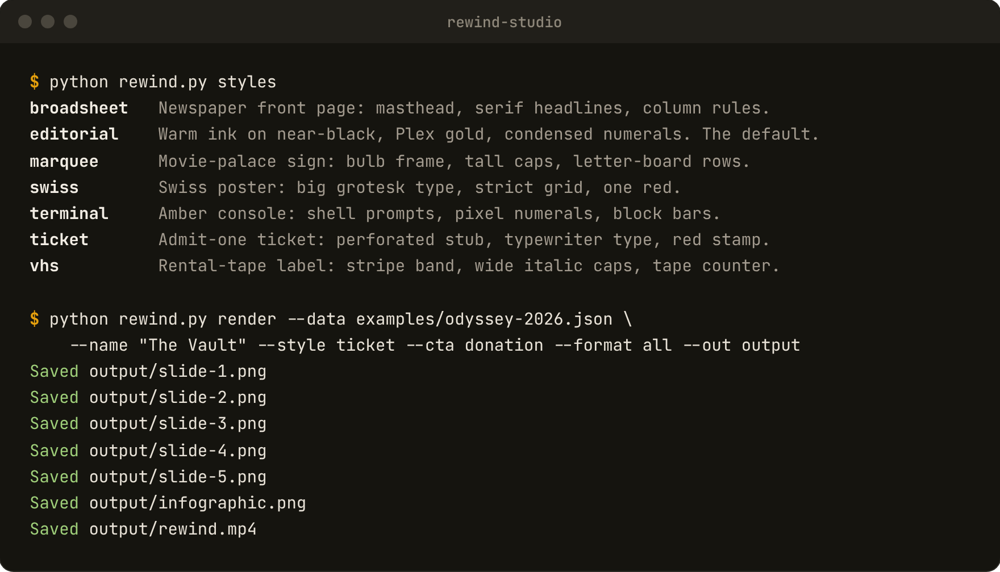

*`python rewind.py styles` lists the designs. Add `--style` to pick one; this run used `--style ticket`.*

That renders the bundled example stats under the name "The Vault": five slides, the infographic and the video, in `output/`. Change `--name` to your server's name. Any name works, from "Jones" to "Movie Night at the Garcia House"; long names shrink to fit.

Then [make one from your own server](#your-own-server).

## Styles

Pick one with `--style`. Every style draws the same numbers. These are the seven covers, left to right: editorial, marquee, ticket, broadsheet, terminal, swiss, vhs.

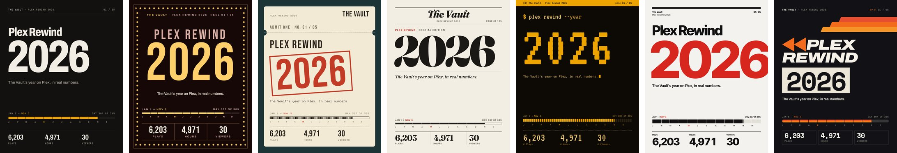

Open a style to see all five slides and the infographic.

<details>
<summary><b><code>editorial</code></b>: warm ink on near-black, Plex gold, condensed numerals, mono labels. Quiet and data-first. The default.</summary>
<br>

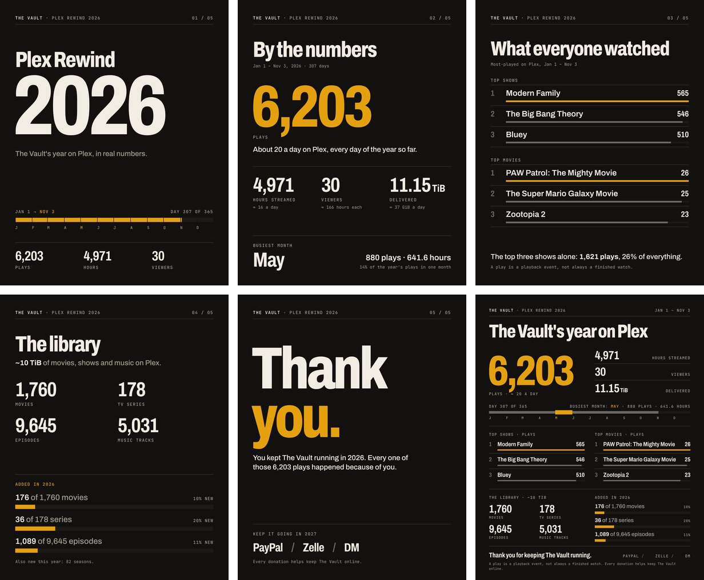

</details>

<details>
<summary><b><code>marquee</code></b>: a movie-palace sign with a bulb frame, tall caps and letter-board rows.</summary>
<br>

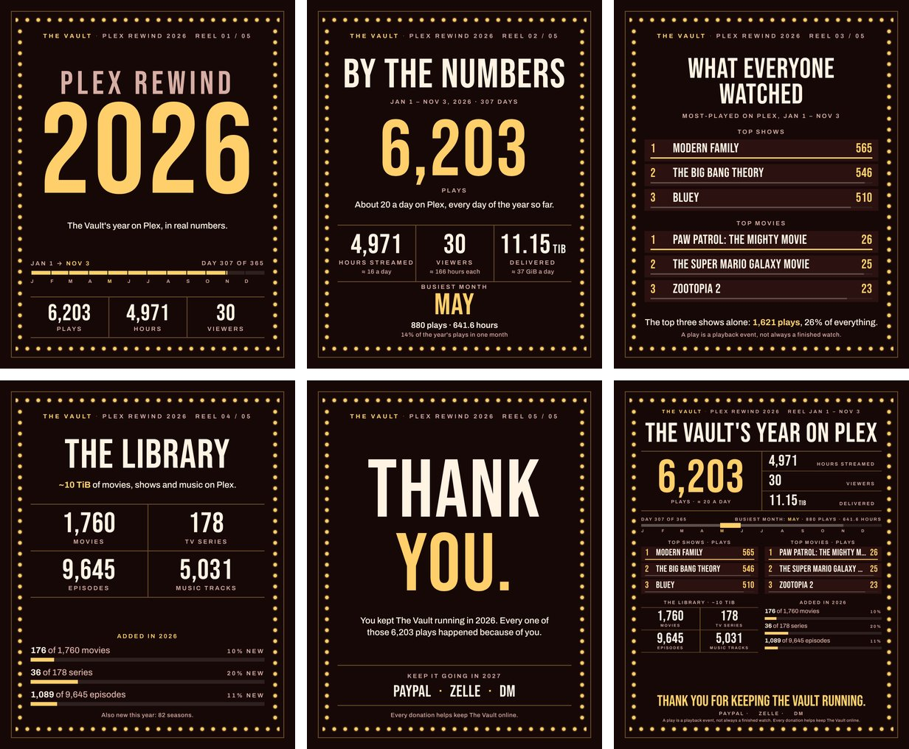

</details>

<details>
<summary><b><code>ticket</code></b>: admit-one ticket stock with a perforated stub, typewriter details and a red stamp.</summary>
<br>

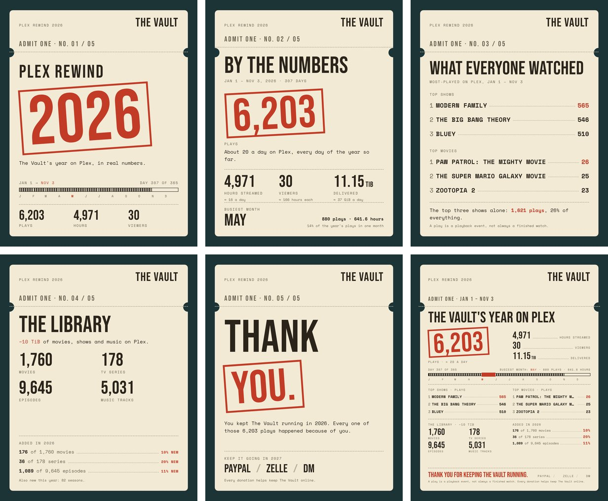

</details>

<details>
<summary><b><code>broadsheet</code></b>: a newspaper front page with your server's name as the masthead, serif headlines and column rules.</summary>
<br>

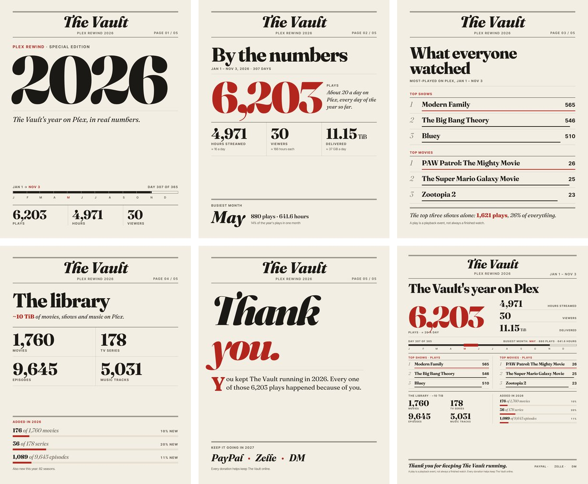

</details>

<details>
<summary><b><code>terminal</code></b>: an amber-phosphor console with shell prompts, pixel numerals and block bars. In video, lines print like terminal output.</summary>
<br>

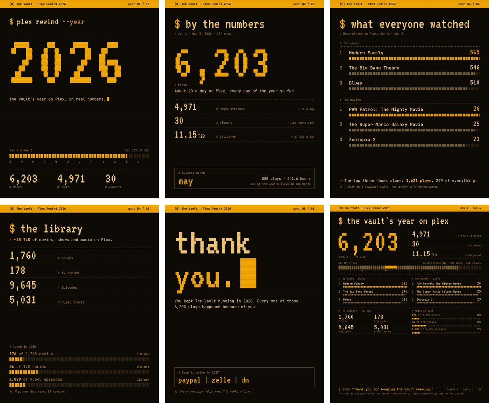

</details>

<details>
<summary><b><code>swiss</code></b>: International Typographic Style. Poster-scale grotesk, a strict grid, one red.</summary>
<br>

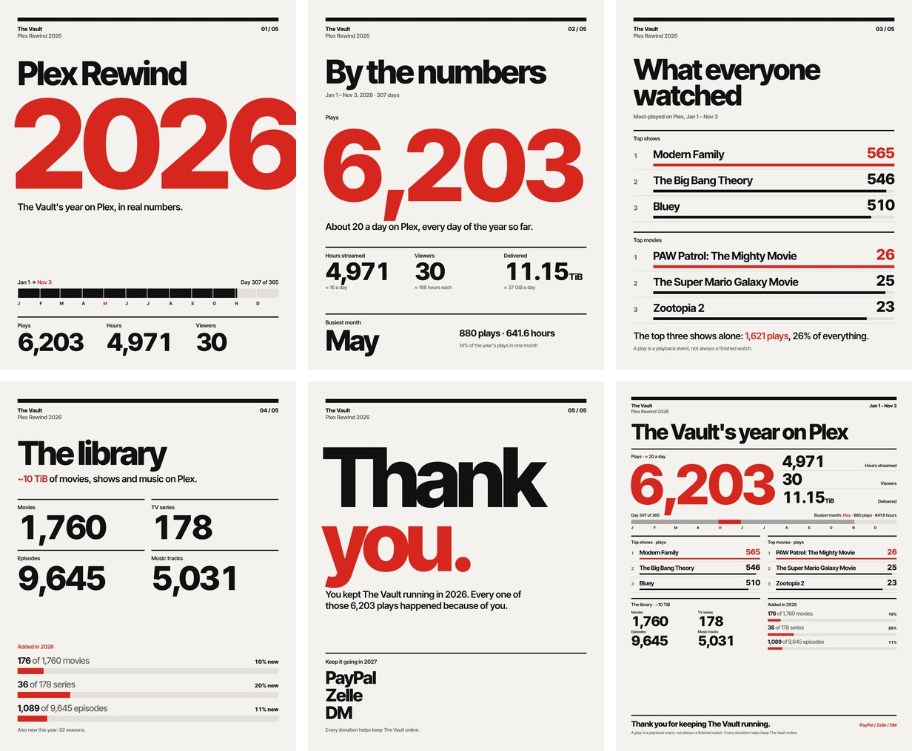

</details>

<details>
<summary><b><code>vhs</code></b>: a rental-tape label with a stripe band, wide italic caps and tape-counter numbers.</summary>
<br>

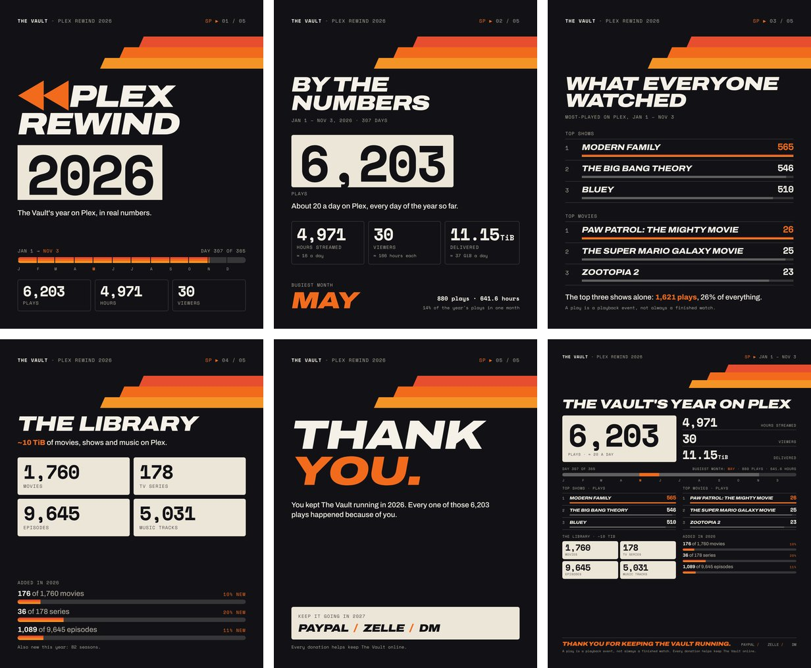

</details>

Each style is a single stylesheet over shared markup, so adding your own doesn't touch any Python. See [`studio/styles/README.md`](studio/styles/README.md).

## Your own server

1. **Get a standalone backup** of your Plex library database (`com.plexapp.plugins.library.db`, usually with a date suffix). Never point Rewind Studio at the live database while Plex is writing to it. The [setup guide](docs/GETTING_STARTED.md#4-find-your-own-plex-library-backup) lists where backups live on Windows, macOS, Linux, Docker and NAS installs.
2. **Extract the stats:**

   ```bash
   python rewind.py extract --db "/full/path/to/your/plex-backup.db" --year 2026 --out stats.json
   ```

3. **Optional:** add `"library_size_label": "~10 TiB"` to `stats.json`. Plex's database doesn't know how big your library is on disk.
4. **Render:**

   ```bash
   python rewind.py render --data stats.json --name "Your Server" --style marquee --cta thanks --format all --out output
   ```

`stats.json` holds aggregated counts and top titles only, with no account names or per-person history. It still describes your library, so look it over before sharing it.

## Options

| Option | What it does |
|---|---|
| `--name "Your Server"` | Your server's name, shown on every slide (default: My Media Server) |
| `--style NAME` | `editorial` (default), `marquee`, `ticket`, `broadsheet`, `terminal`, `swiss`, `vhs` |
| `--format` | `slides` (default), `infographic`, `both`, `video`, `all` |
| `--cta` | Closing slide: `none` (default), `thanks`, or `donation` |
| `--cta-text "…"` | Write the closing message yourself |
| `--cta-methods "Ko-fi / Venmo"` | Donation options to list (default: PayPal / Zelle / DM) |
| `--theme NAME` | Recolor and relabel a style with a template from [`templates/`](templates/) (`aurora`, `forest`, or your own) |
| `--no-sound` | Video without the sound bed |

Templates are small JSON files with five colors and optional headline text. `python rewind.py templates` lists them, and [`templates/README.md`](templates/README.md) describes the format.

## Accurate, not decorative

Every number on a card comes from your stats or from plain arithmetic on them, like plays per day, the top shows' share of all plays, or how much of the library was added this year. Nothing is estimated. When your stats don't include something (no busiest month, no music library, fewer than three top titles), that part is left out rather than filled in. A "play" is a playback event, not necessarily a finished watch, and the cards say so.

## How it works

`rewind.py extract` reads a read-only, immutable copy of your database backup. `rewind.py render` loads the shared markup with a style's stylesheet in headless Chromium (through [Playwright](https://playwright.dev/python/)) and screenshots each card. Fonts are bundled ([SIL Open Font License](studio/fonts/)), so renders look identical on every machine and never fetch anything from the network. For video, each card's motion is stepped frame by frame and encoded with ffmpeg; the sound is synthesized with numpy, so there are no audio files to license.

Already have Chrome or Chromium installed? Set `REWIND_CHROMIUM` to its path and skip `playwright install`.

```text
rewind.py                  CLI: extract, render, styles, templates
requirements.txt           Playwright + numpy
examples/odyssey-2026.json Sample aggregated stats
studio/model.py            Stats -> the numbers and sentences on the cards
studio/base.html           Shared markup for all six cards
studio/styles/<name>/      One stylesheet + metadata per style
studio/runtime/            Data binding, shrink-to-fit and motion
studio/engine.py           Chromium rendering and video export
studio/sound.py            Synthesized sound bed
studio/fonts/              Bundled open-license fonts
templates/                 Color and label templates
docs/                      Setup guide, troubleshooting, images
docs/make_images.py        Regenerates every README image from the example stats
```

## More

- [Setup guide](docs/GETTING_STARTED.md): Windows, macOS, Linux, Docker, NAS and seedbox
- [Troubleshooting](docs/TROUBLESHOOTING.md)
- [Make a style](studio/styles/README.md)

Rewind Studio is an early command-line tool and hasn't been tested against every Plex version yet. Odyssey, the server the example stats come from, is just the sample; use any name.

Not affiliated with Plex.
