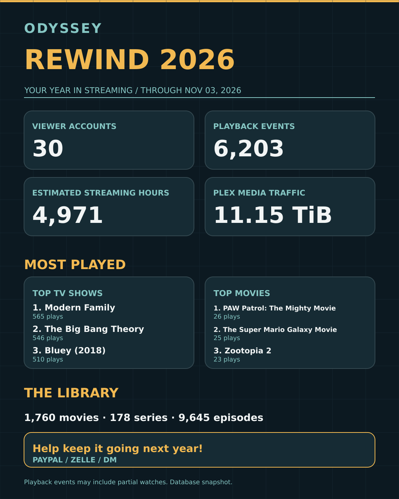

# Rewind Studio

> **Open-source, local-first Plex Year in Review generator.** Create Instagram-ready slides or a single-page infographic from a safe Plex database backup. Custom themes, any server name, optional donation message, and no hosted service required.

**Your server. Your story.** Turn aggregated Plex playback statistics into an Instagram-ready, five-slide yearly recap **or a single-page infographic**. Works with **any server name**; Odyssey is merely the example dataset.


*Illustrative preview of the classic renderer. For designed layouts and MP4 video, see [Designed styles](#designed-styles-and-video).*

## Start here

**[Full setup guide: Windows, macOS, Linux, Docker, NAS / seedbox](docs/GETTING_STARTED.md)** · **[Custom theme reference](templates/README.md)** · **[Troubleshooting](docs/TROUBLESHOOTING.md)**

Requirements: Python 3.10+ and Pillow. No hosted service, Plex authentication token, or AI account is required. The optional [designed styles](#designed-styles-and-video) also need Playwright (headless Chromium), and video needs ffmpeg.

```bash
git clone https://github.com/antonflor/rewind-studio.git
cd rewind-studio
python -m pip install -r requirements.txt
python rewind.py render --data examples/odyssey-2026.json --name "My Server" --theme odyssey --cta none --out output
```

Your images appear at `output/slide-1.png` through `slide-5.png`.

### Choose your output format

Use `--format` with **any** server name and any built-in or custom theme.

| Option | Files generated | Best for |
|---|---|---|
| `--format slides` | `slide-1.png` through `slide-5.png` | Instagram carousel (default) |
| `--format infographic` | `infographic.png` | Single Instagram feed image |
| `--format both` | All six PNG files | Both layouts in one run |

```bash
python rewind.py render --data stats.json --name "The Vault" --format slides --out output
python rewind.py render --data stats.json --name "The Vault" --format infographic --out output
python rewind.py render --data stats.json --name "The Vault" --format both --out output
```

All exports are 1080 × 1350 PNGs. Donations are optional using `--cta none|thanks|donation`.

### Single-page infographic preview



*SVG recreation of the generated infographic using the real Odyssey sample statistics. It illustrates the current infographic layout; the command below produces a full-resolution PNG.*

### Single-page infographic (new)

Create one **1080 × 1350 PNG** containing the year's leading metrics, top TV shows and movies, library totals, and an optional closing message:

```bash
python rewind.py render --data examples/odyssey-2026.json --name "Odyssey" --theme odyssey --cta donation --format infographic --out output/infographic
```

The generated image is `output/infographic/infographic.png`.

Generate **both** the five-slide carousel and the single-page image using `--format both`. The default remains `--format slides`, so existing commands continue to work.

To avoid donations, use `--cta none`. Replace `--name "Odyssey"` with **any server name**. The same custom template files under `templates/` style either format.

### From your own Plex DB backup

Obtain a **complete standalone scheduled backup** of your Plex library database (never copy the live SQLite file while Plex is writing). **Every installation can have a different file path.** Use `--db` to point to your own backup:

```bash
python rewind.py extract --db "/full/path/to/your/plex-backup.db" --year 2026 --out stats.json
python rewind.py render --data stats.json --name "The Vault" --theme odyssey --cta thanks --out output
```

See the [setup guide](docs/GETTING_STARTED.md) for common Windows, macOS, Linux, Docker, and hosted seedbox locations.

### Designed styles and video

Seven designed styles render the same stats as five slides, a single-page infographic **and an animated MP4 with a light sound bed**. They run in headless Chromium on your machine, using bundled open-license fonts, so nothing is uploaded and nothing is fetched while rendering.

```bash
python -m pip install -r requirements-studio.txt
python -m playwright install chromium
python rewind.py styles
python rewind.py render --data examples/odyssey-2026.json --name "The Vault" --style editorial --cta donation --format all --out output/editorial
```

`--format all` writes `slide-1.png` … `slide-5.png`, `infographic.png` and `rewind.mp4` (about 30 seconds, 1080 × 1350, H.264 + AAC; needs [ffmpeg](https://ffmpeg.org/download.html) on your PATH). `--format video` writes only the video; add `--no-sound` for a silent one. Any `--theme` recolors a style using its five colors.

The styles are written for **any server**: names of any length shrink to fit, and anything your stats don't have (no busiest month, no music library, only two top shows) is simply left out. With `--cta donation`, set your own options with `--cta-methods "Ko-fi / Venmo / Ask me"` (default: PayPal / Zelle / DM). The gallery below uses the example statistics under the name "The Vault".

**`editorial`**: warm ink on near-black, Plex gold, condensed numerals, mono labels. Based on the hand-designed Odyssey slides.


**`marquee`**: a movie-palace sign with a bulb frame, tall caps and letter-board rows.


**`ticket`**: admit-one ticket stock with a perforated stub, typewriter details and a red stamp.


**`broadsheet`**: a newspaper front page with a masthead, serif headlines and column rules.


**`terminal`**: an amber-phosphor console with shell prompts, pixel numerals and block bars.


**`swiss`**: International Typographic Style. Poster-scale grotesk, strict grid, one red.


**`vhs`**: a rental-tape label with a stripe band, wide italic caps and tape-counter numbers.


Each style is a single stylesheet over shared markup. [`studio/styles/README.md`](studio/styles/README.md) explains how to make your own.

### Custom themes

All user-contributed templates live in **[`templates/`](templates/)**. Copy `aurora.json` or `forest.json`, edit hex colors, copy, and optionally add a local background JPG/PNG.

```bash
python rewind.py templates
python rewind.py render --data stats.json --name "Movie Night" --theme aurora --cta none --out output/aurora
```

You can also pass a full JSON file path to `--theme`. Custom templates currently support colors, selected text labels, and a blended background; custom slide geometry and custom fonts are not available yet.

### Optional closing slide

| Setting | Result |
|---|---|
| `--cta none` | General closing, no payment request (**default**) |
| `--cta thanks` | Thank-you message |
| `--cta donation` | Donation message mentioning PayPal, Zelle, or DM |
| `--cta-text "Your text"` | Override the closing message |
| `--cta-methods "Ko-fi / Venmo"` | Donation options to list (default: PayPal / Zelle / DM) |

### What we generate

1. Rewind title and year
2. Viewer count, playback events, estimated streaming hours, bandwidth
3. Top TV shows and movies
4. Library snapshot and year-to-date additions
5. Closing slide (no donation required)

Or use the single-page infographic to combine the key stats into one post. Designed styles add the busiest month, per-day averages and how much of the library is new this year, all calculated from the same stats.

The program exports aggregated counts and titles, not individual viewer histories or account names. Counts and durations depend on the database backup's coverage; play events are not completed watches.

## Project layout

```text
rewind.py                  Plex extractor + CLI + classic (Pillow) renderer
requirements.txt           Pillow dependency
requirements-studio.txt    Optional: Playwright + numpy for designed styles and video
studio/                    Designed styles engine: model, shared markup, styles, fonts, video
examples/odyssey-2026.json   Aggregated sample data
templates/                 Reusable user-defined themes
docs/GETTING_STARTED.md    Complete install and usage guide
docs/TROUBLESHOOTING.md    Common issues
docs/images/               Documentation graphics
output/                    Generated images (gitignored)
```

## Current status

This is an **early CLI MVP**, not a web app. It has not yet been validated across all Plex versions and operating systems. The classic renderer is deliberately simple; the designed styles add hand-designed layouts and MP4 export. Drag-and-drop layouts and visual editing remain future improvements.

Not affiliated with Plex.
