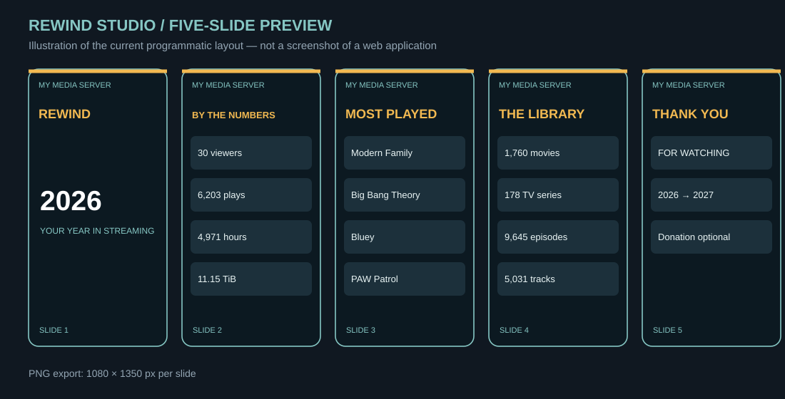

# Rewind Studio

**Your server. Your story.** Turn aggregated Plex playback statistics into an Instagram-ready, five-slide yearly recap. Works with **any server name**; Odyssey is merely the example dataset.



*Illustrative graphic preview (not a browser screenshot). Current exports are 1080 × 1350 PNG images, not MP4 videos.*

## Start here

**[Full setup guide: Windows, macOS, Linux, Docker, NAS / seedbox](docs/GETTING_STARTED.md)** · **[Custom theme reference](templates/README.md)** · **[Troubleshooting](docs/TROUBLESHOOTING.md)**

Requirements: Python 3.10+ and Pillow. No hosted service, Plex authentication token, or AI account is required.

```bash
git clone https://github.com/antonflor/rewind-studio.git
cd rewind-studio
python -m pip install -r requirements.txt
python rewind.py render --data examples/odyssey-2026.json --name "My Server" --theme odyssey --cta none --out output
```

Your images appear at `output/slide-1.png` through `slide-5.png`.

### From your own Plex DB backup

Obtain a **complete standalone scheduled backup** of your Plex library database (never copy the live SQLite file while Plex is writing). **Every installation can have a different file path.** Use `--db` to point to your own backup:

```bash
python rewind.py extract --db "/full/path/to/your/plex-backup.db" --year 2026 --out stats.json
python rewind.py render --data stats.json --name "The Vault" --theme odyssey --cta thanks --out output
```

See the [setup guide](docs/GETTING_STARTED.md) for common Windows, macOS, Linux, Docker, and hosted seedbox locations.

### Custom themes

All user-contributed templates live in **[`templates/`](templates/)**. Copy `aurora.json` or `forest.json`, edit hex colors, copy, and optionally add a local background JPG/PNG.

```bash
python rewind.py templates
python rewind.py render --data stats.json --name "Movie Night" --theme aurora --cta none --out output/aurora
```

You can also pass a full JSON file path to `--theme`. Custom templates currently support colors, selected text labels, and a blended background; custom slide geometry and custom fonts are not available yet.

### Optional closing slide

| Setting | Result |
|---|---|
| `--cta none` | General closing, no payment request (**default**) |
| `--cta thanks` | Thank-you message |
| `--cta donation` | Donation message mentioning PayPal, Zelle, or DM |
| `--cta-text "Your text"` | Override the closing message |

### What we generate

1. Rewind title and year
2. Viewer count, playback events, estimated streaming hours, bandwidth
3. Top TV shows and movies
4. Library snapshot and year-to-date additions
5. Closing slide (no donation required)

The program exports aggregated counts and titles, not individual viewer histories or account names. Counts and durations depend on the database backup's coverage; play events are not completed watches.

## Project layout

```text
rewind.py                  Plex extractor + slide renderer
requirements.txt           Pillow dependency
examples/odyssey-2026.json   Aggregated sample data
templates/                 Reusable user-defined themes
docs/GETTING_STARTED.md    Complete install and usage guide
docs/TROUBLESHOOTING.md    Common issues
docs/images/               Documentation graphics
output/                    Generated images (gitignored)
```

## Current status

This is an **early CLI MVP**, not a web app. It has not yet been validated across all Plex versions and operating systems. Generated graphics are simpler than the original hand-designed Odyssey slides. Automated animated MP4 export, drag-and-drop layouts, and visual editing remain future improvements.

Not affiliated with Plex.
