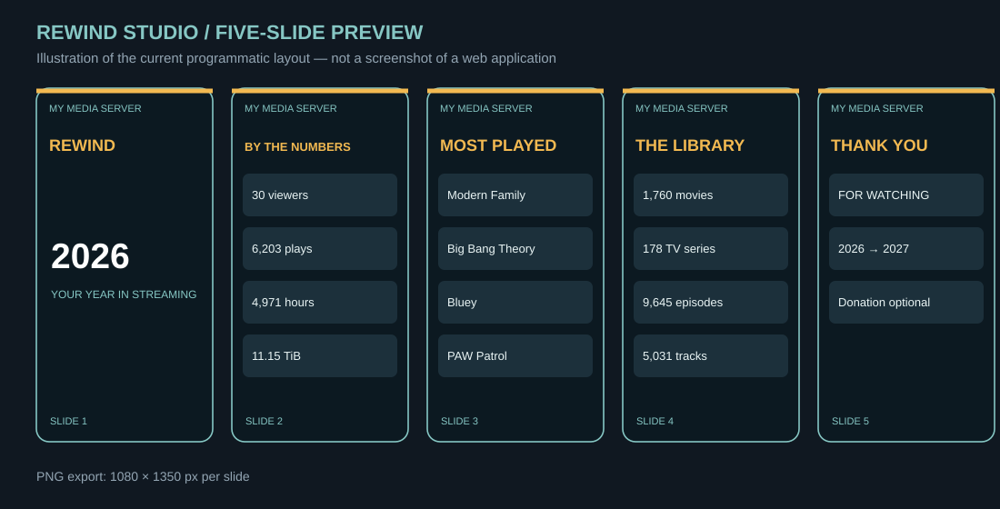

# Getting started

Rewind Studio is a **command-line program**, not yet a website. It currently produces **five 1080 × 1350 PNG slides**, which can be posted as an Instagram carousel. This guide starts with a safe sample before touching a Plex database.

## 1. Install prerequisites

Install [Python 3.10+](https://www.python.org/downloads/) and [Git](https://git-scm.com/downloads/). On Windows, check **Add Python to PATH** during installation.

Open PowerShell (Windows) or Terminal (macOS/Linux):

| Platform | Check Python | Check Git |
|---|---|---|
| Windows | `py --version` | `git --version` |
| macOS | `python3 --version` | `git --version` |
| Linux | `python3 --version` | `git --version` |

Commands below use `python`. On Windows substitute `py`, and on macOS/Linux substitute `python3` if needed.

## 2. Download and install

```bash
git clone https://github.com/antonflor/rewind-studio.git
cd rewind-studio
python -m venv .venv
```

Activate your environment:

- **Windows PowerShell:** `.venv\Scripts\Activate.ps1` (if blocked, use `.venv\Scripts\python.exe` directly)
- **Windows Command Prompt:** `.venv\Scripts\activate.bat`
- **macOS/Linux:** `source .venv/bin/activate`

Then:

```bash
python -m pip install -r requirements.txt
python rewind.py --help
```

## 3. Generate an example — no Plex server required

```bash
python rewind.py render --data examples/odyssey-2026.json --name "My Media Server" --theme odyssey --cta none --out output/demo
```

Look in `output/demo/` for `slide-1.png` through `slide-5.png`.



*This is an illustrative preview of the built-in graphic layouts, not a captured screenshot from an app UI. Output fonts may vary by operating system.*

## 4. Find your own Plex library backup

Rewind Studio does **not** assume a fixed installation location. You must choose a **complete, standalone backup** of `com.plexapp.plugins.library.db`, often with a dated suffix. Do **not** point it at the active, changing Plex database. Never use the `blobs.db` file.

Common locations:

| Installation | Typical data location (varies) |
|---|---|
| Windows | `%LOCALAPPDATA%\Plex Media Server\Plug-in Support\Databases` |
| macOS | `~/Library/Application Support/Plex Media Server/Plug-in Support/Databases` |
| Linux | `/var/lib/plexmediaserver/Library/Application Support/Plex Media Server/Plug-in Support/Databases` |
| Docker | Host folder bound to Plex `/config`, followed by its library data path |
| NAS / seedbox | Vendor-specific application data directory |

Linux example (only if those paths exist):

```bash
find "$HOME" /var/lib/plexmediaserver -type f -name 'com.plexapp.plugins.library.db-20*' 2>/dev/null
```

For Windows, open File Explorer, paste `%LOCALAPPDATA%\Plex Media Server\Plug-in Support\Databases` into the address bar, and inspect the dated backup files. Copy the backup to your computer if the server is remote. The exact filename varies with Plex version and backup schedule.

## 5. Extract data safely

Use **your** database backup path:

```bash
python rewind.py extract --db "/full/path/to/your/plex-backup.db" --year 2026 --out stats.json
```

For Windows PowerShell, for example:

```powershell
py rewind.py extract --db "C:\Users\YourName\Downloads\plex-backup.db" --year 2026 --out stats.json
```

`stats.json` stores aggregated counts and top titles; it does **not** include account names or individual account playback rows. It may still reveal information about your media library, so inspect it before sharing.

Optional: edit `stats.json` to set `"library_size_label": "~10 TiB"`, which Plex's database does not determine.

## 6. Generate your recap

```bash
python rewind.py render --data stats.json --name "The Vault" --theme odyssey --cta none --out output/the-vault
```

For a thank-you ending: `--cta thanks`

For an optional donation message: `--cta donation --cta-text "Your support kept us online. Here's to next year!"`

You can name the server anything. **Odyssey is example data, not a requirement.**

## 7. Create your own theme

Run `python rewind.py templates` to list built-in themes and files under `templates/`.

Copy `templates/aurora.json` to `templates/my-theme.json`, then edit its color hex values and text labels. Run:

```bash
python rewind.py render --data stats.json --name "The Vault" --theme my-theme --cta none --out output/my-theme
```

You can also use `--theme "/path/to/custom-theme.json"`. See [template reference](../templates/README.md) for supported keys and optional background images.

## 8. Generate a single-page infographic

Instead of five individual slides, combine the same data into one 1080 × 1350 PNG:

```bash
python rewind.py render --data stats.json --name "The Vault" --theme odyssey --cta none --format infographic --out output/one-page
```

Look for `output/one-page/infographic.png`. With `--cta donation`, the closing panel mentions PayPal, Zelle, and DM; with `--cta none`, it simply thanks viewers. Set `--format both` to generate the one-page image **and** all five slides in one command.

Both formats support names other than Odyssey and the custom JSON templates in `templates/`.

## 9. Post to Instagram

Upload the five generated PNGs as a carousel, preserving their order, **or** upload the standalone `infographic.png` as one feed post. Instagram Stories and Reels are taller than these PNGs; this version **does not yet create an MP4**. To create a video manually, import PNGs into an editor, animate the movement/transitions, and export a vertical 1080 × 1920 MP4.

## Common problems

See [Troubleshooting](TROUBLESHOOTING.md). Use `python rewind.py --help`, `python rewind.py extract --help`, and `python rewind.py render --help` to inspect available options.
